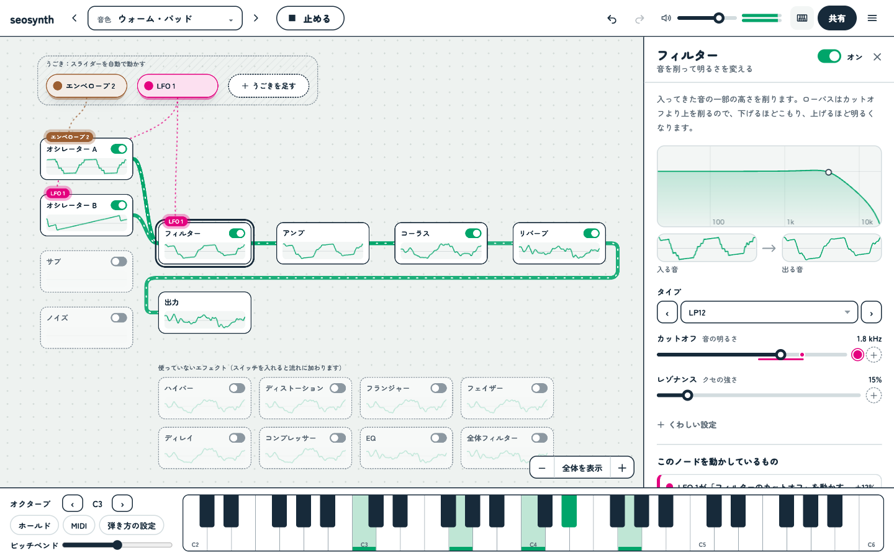

# seosynth — ブラウザで動くウェーブテーブルシンセ

Rust で書いたシンセエンジンを WebAssembly にして、ブラウザの AudioWorklet で鳴らすウェーブテーブルシンセサイザーです。インストール不要で、作った音色は URL で共有できます。

*A wavetable synthesizer whose DSP engine is written in Rust, compiled to WebAssembly and run in an AudioWorklet. Nothing to install, and every sound can be shared as a link. [English summary below](#english).*



## 特長

**音の全体像がグラフで見える**

- 画面の中心はホワイトボードです。音の通り道がノードと線のグラフとして描かれ、ドラッグで動かし、ピンチやホイールで拡大できます
- 経路上のノード（オシレーター、サブ、ノイズ、フィルター、エフェクト）にはオン・オフのスイッチがあります。**スイッチの入ったノードだけを通って、線が出力まで届きます**。音が流れている線は濃く光って動きます
- 音源は並列に合流し、フィルターを通さない音源は横をすり抜ける線で描かれます。使っていないエフェクトは経路の下で待機し、スイッチを入れると流れに加わります
- **エフェクトは重ねられ、途中で 2 本に分けられます**。同じエフェクトを 3 つまで置けます。設定パネルで「通る道」を選ぶと流れが 2 本に分岐し、低音だけ・高音だけ、中央だけ・左右だけにエフェクトをかけてから、もう一度まとめられます


- ノードを押すと設定パネルが開きます（PC は右側、スマホは下からのシート）。どのパネルも「説明 → 図（入る音と出る音の波形つき）→ おもなスライダー → くわしい設定 → つながり」の順に並びます
- つまみではなくスライダーを使います。左が少なく右が多い、という向きがすぐ分かり、名前を略さずに書けます
- **うごき**（LFO、エンベロープ、マクロ、弾く強さなど）は経路とは別の層に浮かぶノードです。「うごきを足す」で追加し、設定パネルでつなぐ先のノードとスライダーを選びます。つないだノードには色のタグが付き、破線で結ばれ、スライダーには動く範囲といまの値が表示されます
- 色を持つのは線だけです。緑は音、ほかの色は「うごき」ひとつずつ。それ以外は紙と墨の 2 色です
- 日本語／英語、明るい画面／暗い画面を切り替えられます。8 ステップの「はじめてガイド」つき


**シンセとしての機能（SERUM を参考にした構成）**

| | |
|---|---|
| オシレーター | ウェーブテーブル ×2（22 種類のテーブル、波形の位置のモーフィング、ユニゾン最大 16 声、ワープ 13 種：Sync / Bend / PWM / Asym / Flip / Mirror / Quantize / FM / AM / RM）、サブ、ノイズ |
| フィルター | 19 種類（LP / HP / BP / ノッチ / ピーク / ラダー / モーフ / コム / フェイザー / フォルマント ほか）、ドライブ、キー追従、ステレオ |
| うごき | エンベロープ ×3（AHDSR＋カーブ）、LFO ×4（プリセット波形または自分で描く、テンポ同期）、マクロ ×4、弾く強さ／音の高さ／MOD ホイールなど。最大 32 のつながり |
| エフェクト | ハイパー、ディストーション、フランジャー、フェイザー、コーラス、ディレイ、コンプレッサー、リバーブ、EQ、全体フィルター。順番を入れ替え可能、同じものを 3 つまで重ねがけ、途中で 2 本に分岐（同じ音を 2 つに／低音と高音／中央と左右／左と右） |
| 演奏 | 画面の鍵盤、PC キーボード、MIDI キーボード（Web MIDI）、「聴く」ボタンでのフレーズ再生、ポリ 16 声／モノ／レガート／グライド |

**共有と書き出し**

- **リンクで共有**：音色の設定はすべて URL の `#p=…` の中に入ります。サーバーには何も保存しません。アドレスバーの URL は編集のたびに更新されるので、そのままコピーしても共有できます
- **ファイル**：読みやすい JSON（`.seosynth.json`）で保存・読み込み
- **Serum 2 用の書き出し**：`.SerumPreset` と、必要なウェーブテーブルの WAV を書き出します（[下記の注意](#serum-2-への書き出しについて)を読んでください）

## 動かす

必要なもの：Rust（`wasm32-unknown-unknown` ターゲット）と Node.js 20 以上。npm パッケージのインストールは不要です。

```sh
rustup target add wasm32-unknown-unknown   # 初回のみ
npm run build                              # Rust → web/wasm/seosynth.wasm
npm run dev                                # http://localhost:8080
```

`web/` フォルダは、ビルドした `seosynth.wasm` を含めれば、そのまま静的サイトとして配信できます。

書体は Google Fonts の Zen Maru Gothic を読み込んでいます（`web/index.html`）。外部への読み込みを避けたい場合はその `<link>` を消してください。Mac ではヒラギノ丸ゴ、ほかでは各 OS のゴシック体で表示されます。

### テスト

```sh
npm test
```

Rust のユニットテスト（DSP・パッチ形式・Serum 書き出し）と、ビルドした wasm を Node から動かすテスト（プリセット全件の読み込みと発音、共有 URL の往復、書き出したファイルの読み戻し）を実行します。

## 構成

```
engine/            Rust のシンセエンジン（依存クレートなし）
  src/params.rs      全パラメータの表（キー・範囲・単位・安定 ID）
  src/wavetable.rs   帯域制限つきウェーブテーブル（ミップマップ）
  src/tables.rs      内蔵ウェーブテーブルの生成
  src/osc.rs         ウェーブテーブルオシレーター（ユニゾン・ワープ）
  src/filter.rs      フィルター
  src/env.rs lfo.rs  エンベロープ、LFO
  src/voice.rs       1 ボイス：音源 → フィルター → アンプ
  src/fx/            エフェクトと、それを並べるチェーン（重ねがけ、分岐）
  src/synth.rs       ボイス管理、モジュレーション、UI 用のタップ／テレメトリ
  src/patch.rs       パッチと共有用バイナリ形式
  src/serum/         Serum 2 プリセットの書き出し
  src/api.rs         WebAssembly の公開関数
web/               Web アプリ（ビルド不要の ES モジュール）
  js/engine/         wasm のラッパー、AudioWorklet
  js/store.js        パッチの状態管理（undo、JSON、URL）
  js/ui/nodes.js     ノードのつながり方と、エフェクトチェーンの編集
  js/ui/board.js     ホワイトボード（ノード、線、パン／ズーム）
  js/ui/panel.js     ノードごとの設定パネル
  js/ui/controls.js  スライダーなどの部品
  js/ui/displays.js  波形・フィルター特性・エンベロープ・LFO の表示
  js/ui/mods.js      「うごき」とスライダーのつながり
  js/i18n.js         文言（日本語／英語）
  js/presets.js      内蔵プリセット
tests/             Node から wasm と Web 側モジュールを検証
```

エンジンの wasm はブラウザ内で 2 つインスタンス化されます。1 つは AudioWorklet（音声スレッド）で音を出し、もう 1 つはメインスレッドでパッチの正本を持ち、波形やフィルター特性のプレビューを描くのに使います。エンジンは `extern "C"` の素の関数だけを公開しているので、JS のグルーコードなしで AudioWorklet の中から読み込めます。

### 共有 URL の形式

パッチは「初期値と違うものだけ」をコンパクトなバイナリにし、base64url で URL のフラグメントに入れます（プリセットで 150〜300 文字程度）。パラメータは変更されない「安定 ID」で記録するので、あとからパラメータを追加しても古い URL は開けます。詳細は `engine/src/patch.rs` の冒頭にあります。

## Serum 2 への書き出しについて

- `.SerumPreset` は **公開されていない形式** です。コミュニティによる解析（下記）をもとに、ヘッダー＋JSON メタデータ＋Zstandard 圧縮した CBOR という構造で書き出しています
- 書き出したファイルは、別実装の zstd／CBOR デコーダーで読み戻し、Serum 2 の初期プリセットとモジュール構成が一致することを確認しています。ただし **Serum 2 本体での読み込みは未確認** です（開発環境に Serum がないため）。読み込めない場合は Issue で教えてください
- seosynth と Serum は別のシンセなので、同じ音にはなりません。スライダーの位置、つながり、エフェクトの順番を移し替えるものです。移し替えられなかった項目は、書き出しダイアログの「変換メモ」に表示されます
- 重ねたエフェクトは、同じ種類のモジュールを並べて書き出します。分岐は Serum 側の配線の書き方が確認できていないため、1 本に並べ直して書き出します
- Serum はウェーブテーブルを自分のフォルダから読み込むため、テーブルは WAV として別に書き出します。`Serum 2 Presets/Tables/seosynth/` に置いてください（ZIP にまとめてダウンロードできます）

形式の調査で参考にしたもの：

- [KennethWussmann/serum-preset-packager](https://github.com/KennethWussmann/serum-preset-packager)（コンテナ形式）
- [btesser/serum2vital](https://github.com/btesser/serum2vital) のドキュメント（パラメータの単位、エフェクト、モジュレーション元の ID）
- [ThatMajd/PySerum](https://github.com/ThatMajd/PySerum)（モジュレーション先の ID）

Serum は Xfer Records の製品です。このプロジェクトは Xfer Records とは関係ありません。

## GitHub に上げる／公開する

```sh
gh repo create seosynth --source . --public --push   # または git remote add … && git push
```

`.github/workflows/` に 2 つのワークフローが入っています。

- `test.yml`：push と Pull Request でテストを実行
- `pages.yml`：`main` への push で wasm をビルドし、`web/` を GitHub Pages に公開。リポジトリの Settings → Pages → Source を「GitHub Actions」にすると有効になります

## これから

Serum 2 と比べて足りない機能と、作っていく順番を [docs/roadmap.md](docs/roadmap.md) にまとめています。次はウェーブテーブルの手描きと音声取り込みです。

そのほか：

- オシレーターのオーバーサンプリング（ワープを強くかけたときのエイリアシング低減）
- Serum 2 本体での書き出し検証と、未対応項目（Env／LFO／FX を行き先にしたつながりなど）の対応

ライセンス：[MIT](LICENSE)

---

<a id="english"></a>

## English

seosynth is a wavetable synthesizer for the browser. The DSP engine is dependency-free Rust compiled to WebAssembly and runs in an AudioWorklet; the UI is plain ES modules with no build step.

- **The whole sound as a graph.** The centre of the screen is a whiteboard you can drag and pinch-zoom. Nodes on the signal path have on/off switches, and the sound line runs through every node that is switched on to the output, brightening where sound flows. Sources run in parallel; effects that are off wait in a tray below. Effects can be stacked (up to three of each) and the chain can split into two lanes that run side by side (two copies, lows and highs, centre and sides, or left and right) and join again. Pressing a node opens its settings (a side panel on desktop, a bottom sheet on phones) with sliders, a picture of the sound going in and coming out, and an explanation.
- **Movement on its own layer.** LFOs, envelopes, macros and playing gestures float on a separate plane. You add one, pick the node and slider it should move, and a coloured tag and dashed line show where it acts.
- **Synth features** modelled on Serum's layout: two wavetable oscillators (22 generated tables, unison, 13 warp modes), sub, noise, a 19-type filter, 3 envelopes, 4 LFOs with drawable shapes, 4 macros, up to 32 connections and ten kinds of effect that can be reordered, stacked and run in parallel. Japanese and English, light and dark.
- **Sharing.** The whole patch is encoded into the URL fragment, so a link is the preset. Presets can also be saved as JSON.
- **Serum 2 export.** Writes a `.SerumPreset` plus the wavetables as WAV. The format is unpublished and the export follows community reverse-engineering; files round-trip through independent decoders and match the structure of a real init preset, but loading in Serum 2 itself has not been verified yet. It is a translation of settings, not a clone of the sound.

```sh
rustup target add wasm32-unknown-unknown
npm run build && npm run dev    # http://localhost:8080
npm test
```

License: [MIT](LICENSE).
