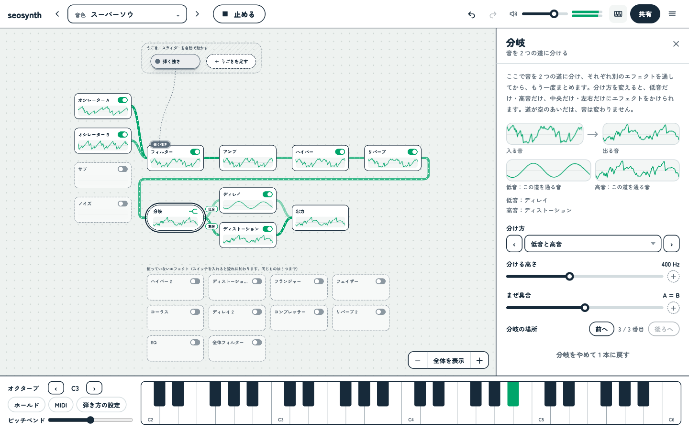
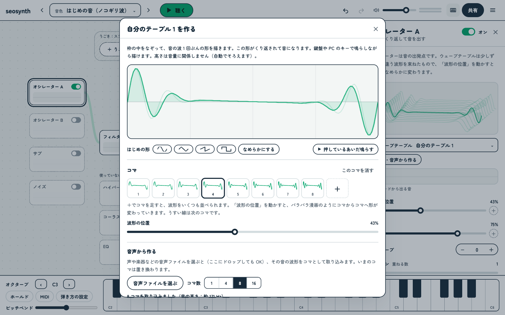
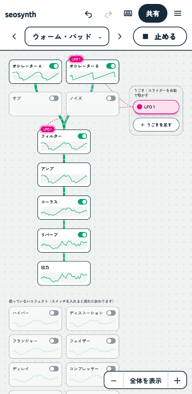
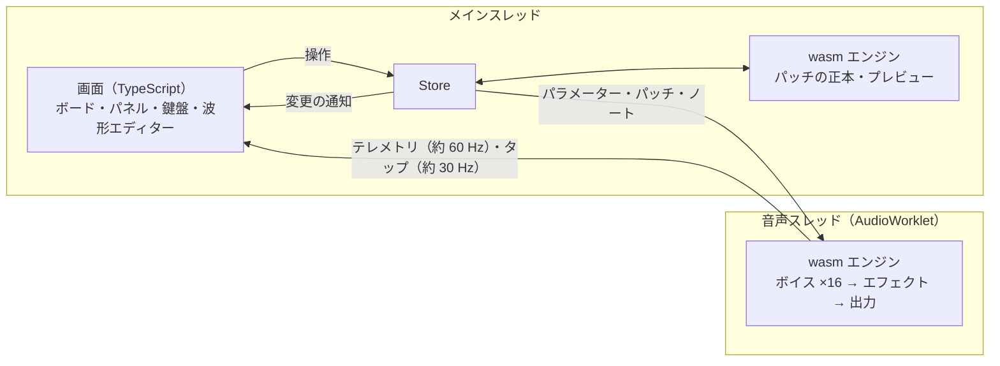

# seosynth — ブラウザで動くウェーブテーブルシンセ

Rust で書いたシンセエンジンを WebAssembly にして、ブラウザの AudioWorklet で鳴らすウェーブテーブルシンセサイザーです。インストール不要で、作った音色は URL で共有できます。

*A wavetable synthesizer whose DSP engine is written in Rust, compiled to WebAssembly and run in an AudioWorklet. Nothing to install, and every sound can be shared as a link. [English summary below](#english).*


## 機能

**音の全体像がグラフで見える**

- 画面の中心はホワイトボードです。音の通り道がノードと線のグラフとして描かれ、ドラッグで動かし、ピンチやホイールで拡大できます
- 経路上のノード（オシレーター、サブ、ノイズ、フィルター、エフェクト）にはオン・オフのスイッチがあります。**スイッチの入ったノードだけを通って、線が出力まで届きます**。音が流れている線は濃く光って動きます
- 音源は並列に合流し、フィルターを通さない音源は横をすり抜ける線で描かれます。使っていないエフェクトは経路の下で待機し、スイッチを入れると流れに加わります
- **エフェクトは重ねられ、途中で 2 本に分けられます**。同じエフェクトを 3 つまで置けます。設定パネルで「通る道」を選ぶと流れが 2 本に分岐し、低音だけ・高音だけ、中央だけ・左右だけにエフェクトをかけてから、もう一度まとめられます



- **波形を自分で描けます**。オシレーターのテーブル一覧から「自分のテーブル」を選ぶと、音の波 1 回ぶんをなぞって描く画面が開き、描いたそばから音が変わります。コマを足せば、パラパラ漫画のように形が移り変わるテーブルになります
- **声や楽器の音からも作れます**。音声ファイルを選ぶと、音の高さを調べて波形を取り出し、コマに並べます。解析はブラウザの中だけで行い、音声はどこにも送りません



- ノードを押すと設定パネルが開きます（PC は右側、スマホは下からのシート）。どのパネルも「説明 → 図（入る音と出る音の波形つき）→ おもなスライダー → くわしい設定 → つながり」の順に並びます
- つまみではなくスライダーを使います。左が少なく右が多い、という向きがすぐ分かり、名前を略さずに書けます
- **うごき**（LFO、エンベロープ、マクロ、弾く強さなど）は経路とは別の層に浮かぶノードです。「うごきを足す」で追加し、設定パネルでつなぐ先のノードとスライダーを選びます。つないだノードには色のタグが付き、破線で結ばれ、スライダーには動く範囲といまの値が表示されます
- 色を持つのは線だけです。緑は音、ほかの色は「うごき」ひとつずつ。それ以外は紙と墨の 2 色です
- 日本語／英語、明るい画面／暗い画面を切り替えられます。8 ステップの「はじめてガイド」つき



**シンセとしての機能（SERUM を参考にした構成）**

| | |
|---|---|
| オシレーター | ウェーブテーブル ×2（22 種類のテーブル＋自分で描く・音声から作るテーブル 2 つ、波形の位置のモーフィング、ユニゾン最大 16 声、ワープ 13 種：Sync / Bend / PWM / Asym / Flip / Mirror / Quantize / FM / AM / RM）、サブ、ノイズ |
| フィルター | 19 種類（LP / HP / BP / ノッチ / ピーク / ラダー / モーフ / コム / フェイザー / フォルマント ほか）、ドライブ、キー追従、ステレオ |
| うごき | エンベロープ ×3（AHDSR＋カーブ）、LFO ×4（プリセット波形または自分で描く、テンポ同期）、マクロ ×4、弾く強さ／音の高さ／MOD ホイールなど。最大 32 のつながり |
| エフェクト | ハイパー、ディストーション、フランジャー、フェイザー、コーラス、ディレイ、コンプレッサー、リバーブ、EQ、全体フィルター。順番を入れ替え可能、同じものを 3 つまで重ねがけ、途中で 2 本に分岐（同じ音を 2 つに／低音と高音／中央と左右／左と右） |
| 演奏 | 画面の鍵盤、PC キーボード、MIDI キーボード（Web MIDI）、「聴く」ボタンでのフレーズ再生、ポリ 16 声／モノ／レガート／グライド |

**共有と書き出し**

- **リンクで共有**：音色の設定はすべて URL の `#p=…` の中に入ります。サーバーには何も保存しません。アドレスバーの URL は編集のたびに更新されるので、そのままコピーしても共有できます
- **ファイル**：読みやすい JSON（`.seosynth.json`）で保存・読み込み
- **Serum 2 用の書き出し**：`.SerumPreset` と、必要なウェーブテーブルの WAV を書き出します（[下記の注意](#serum-2-への書き出し)を読んでください）

### Serum 2 への書き出し

- `.SerumPreset` は **公開されていない形式** です。コミュニティによる解析（下記）をもとに、ヘッダー＋JSON メタデータ＋Zstandard 圧縮した CBOR という構造で書き出しています
- 書き出したファイルは、別実装の zstd／CBOR デコーダーで読み戻し、Serum 2 の初期プリセットとモジュール構成が一致することを確認しています。ただし **Serum 2 本体での読み込みは未確認** です（開発環境に Serum がないため）。読み込めない場合は Issue で教えてください
- seosynth と Serum は別のシンセなので、同じ音にはなりません。スライダーの位置、つながり、エフェクトの順番を移し替えるものです。移し替えられなかった項目は、書き出しダイアログの「変換メモ」に表示されます
- 重ねたエフェクトは、同じ種類のモジュールを並べて書き出します。分岐は Serum 側の配線の書き方が確認できていないため、1 本に並べ直して書き出します
- Serum はウェーブテーブルを自分のフォルダから読み込むため、テーブルは WAV として別に書き出します。`Serum 2 Presets/Tables/seosynth/` に置いてください（ZIP にまとめてダウンロードできます）

形式の調査で参考にしたもの：

- [KennethWussmann/serum-preset-packager](https://github.com/KennethWussmann/serum-preset-packager)（コンテナ形式）
- [btesser/serum2vital](https://github.com/btesser/serum2vital) のドキュメント（パラメータの単位、エフェクト、モジュレーション元の ID）
- [ThatMajd/PySerum](https://github.com/ThatMajd/PySerum)（モジュレーション先の ID）

Serum は Xfer Records の製品です。このプロジェクトは Xfer Records とは関係ありません。

## アーキテクチャ

すべてブラウザの中で動きます。サーバー側の処理はなく、音色もサーバーには保存しません。



### エンジン（Rust → WebAssembly）

- 依存クレートなしの Rust です。`extern "C"` の素の関数だけを公開するので、JS のグルーコードなしで AudioWorklet の中から読み込めます。データは wasm メモリ上の共有バッファでやりとりします
- wasm はブラウザ内で 2 つインスタンス化します。音声スレッドのものが音を出し、メインスレッドのものがパッチの正本を持って、波形・フィルター特性・LFO の形などのプレビューを描くのに使われます
- エンジンは自分自身を JSON で説明します（`describe()`：パラメーター表、選択肢、モジュレーション元、エフェクトの一覧、バッファの配置）。画面側はパラメーターの表を持たず、これをもとに組み立てます

**音の流れ**

1. 1 ボイスごとに、オシレーター A・B（ウェーブテーブル）、サブ、ノイズ → フィルター → アンプ（エンベロープ 1）。音源ごとにフィルターを通すか迂回するかを選べます
2. 最大 16 ボイスを足し合わせ、エフェクトチェーンへ
3. エフェクトは 10 種類 × 3 つ = 30 個のユニットで、並び順と「通る道」（本線・A・B）をユニットごとに持ちます。分岐は 1 か所までで、最初に道 A か B を持つユニットの位置で 2 本に分かれ、まとめ直されます。分け方は、同じ音を 2 つに／低音と高音（4 次の Linkwitz-Riley クロスオーバー）／中央と左右／左と右です
4. マスター音量とソフトクリップ

**ウェーブテーブル**

- 1 コマ 2048 サンプルで、11 段のミップマップに帯域制限して持ちます。鳴らす高さに合わせて、折り返し雑音が出ない段を選びます
- 内蔵の 22 種類は起動後に計算で作ります（音声ファイルは同梱していません）
- 自分のテーブルは 1 コマ 128 点・1 点 1 バイトで、1〜16 コマです。点を直線で結んだ形をそのまま鳴らします。描くたびに変わったコマだけを作り直すので、鳴らしながら描けます

**パラメーターとモジュレーション**

- 全 382 パラメーターを 1 つの表（`params.rs`）で管理します。値は 0〜1 に正規化して持ち、表示や計算のときに実際の単位へ変換します
- 各パラメーターには変わらない「安定 ID」があり、保存形式はこの ID で記録します。パラメーターを足しても、古い URL やファイルはそのまま開けます
- 17 のモジュレーション元（エンベロープ、LFO、弾く強さ、マクロなど）を最大 32 本、205 のパラメーターにつなげます。モジュレーションは正規化した値の上で足し合わせます。ボイスごとのもの（フィルターなど）と全体で 1 つのもの（エフェクトなど）を分けて計算します

**画面へ渡す情報**

- 音の通り道の 42 か所（各音源、フィルターの前後、アンプ、ミックス、エフェクトのユニットごと、分岐の各道、出力）を「タップ」としてリングバッファに記録します。ボードの線の明るさと、パネルの「入る音・出る音」の波形はここから描きます
- 変調後のパラメーター値、エンベロープや LFO の位置、ピーク値などを「テレメトリ」として送ります。スライダー上の動く点や、エンベロープ図の再生位置はこれを使います

### パッチ形式と共有 URL

パッチは「初期値と違うものだけ」をコンパクトなバイナリにし、base64url で URL のフラグメント（`#p=…`）に入れます（プリセットで 150〜300 文字程度）。中身はセクションの並びで、知らないセクションは読み飛ばすので、新旧どちらの版でも開けます。

| セクション | 内容 |
|---|---|
| 1 | 名前 |
| 2 | パラメーター（安定 ID と値。連続値は 16 ビット、離散値は整数） |
| 3 | モジュレーションのつながり |
| 4 | 自分で描いた LFO の形 |
| 5 | エフェクトの順番（旧形式。読み込みのみ） |
| 6 | エフェクトの順番と通る道 |
| 7 | 自分のウェーブテーブル（1 コマ 128 バイト。URL では約 170 文字） |

詳細は `engine/src/patch.rs` の冒頭にあります。ファイル保存には、同じ内容を読みやすくした JSON を使います。

### 画面（TypeScript）

- フレームワークもバンドラーも使わず、DOM を直接組み立てます。`tsc` が 1 ファイルずつ ES モジュールに変換します
- `Store` がパッチへの操作の唯一の入り口です。変更をメインスレッドのエンジンに反映し、音声スレッドへ送り、表示している部品に知らせます。取り消し／やり直しは、パッチのバイナリを履歴として持つ方式です
- 画面の部品は `app` オブジェクト（`src/app.ts`）を受け取って組み立てます。購読はその部品の「スコープ」に登録され、パネルを閉じたときや言語を切り替えたときにまとめて解除されます
- ボード（`ui/board.ts`）は、ノードの並び・分岐・折り返しの配置を計算して、線を SVG で描きます。ノードを押すと、種類ごとの組み立て関数（`ui/panel.ts`）が設定パネルを作ります
- 音声ファイルからのウェーブテーブル作成（`wavetable-import.ts`）は、YIN 法で音の高さを求め、数周期ぶんから倍音の強さと位相を測り、基音の位相をそろえて 128 点に直します

### ディレクトリ構成

```
engine/              Rust のシンセエンジン
  src/params.rs        全パラメーターの表（キー・範囲・単位・安定 ID）
  src/wavetable.rs     帯域制限つきウェーブテーブル、自分のテーブル
  src/tables.rs        内蔵ウェーブテーブルの生成
  src/osc.rs           オシレーター（ユニゾン・ワープ）
  src/sources.rs       サブとノイズ
  src/filter.rs        フィルター
  src/env.rs lfo.rs    エンベロープ、LFO
  src/voice.rs         1 ボイス：音源 → フィルター → アンプ
  src/fx/              エフェクトと、それを並べるチェーン（重ねがけ、分岐）
  src/synth.rs         ボイス管理、モジュレーション、タップとテレメトリ
  src/patch.rs         パッチと共有用バイナリ形式
  src/serum/           Serum 2 プリセットの書き出し
  src/api.rs           WebAssembly の公開関数と自己記述
src/                 画面（TypeScript）
  engine/              wasm のラッパー、AudioWorklet、エンジンの型
  app.ts               画面全体で共有するアプリオブジェクト
  store.ts             パッチの状態管理（取り消し、JSON、URL）
  ui/nodes.ts          ノードのつながり方と、エフェクトチェーンの編集
  ui/board.ts          ホワイトボード（ノード、線、パン／ズーム）
  ui/panel.ts          ノードごとの設定パネル
  ui/mods.ts           「うごき」とスライダーのつながり
  ui/controls.ts       スライダーなどの部品
  ui/displays.ts       波形・フィルター特性・エンベロープ・LFO の表示
  ui/table-editor.ts   波形を描く画面
  wavetable-import.ts  音声ファイルから波形を取り出す解析
  i18n.ts              文言（日本語／英語）
  presets.ts           内蔵プリセット
web/                 静的ファイル（index.html、css）
tests/               ビルドした wasm と画面側のモジュールを Node で検証
docs/                ロードマップ、スクリーンショット
```

ライセンス：[MIT](LICENSE)

---

<a id="english"></a>

## English

seosynth is a wavetable synthesizer for the browser. The DSP engine is dependency-free Rust compiled to WebAssembly and runs in an AudioWorklet; the UI is TypeScript compiled file by file to ES modules, without a framework or bundler.

- **The whole sound as a graph.** The centre of the screen is a whiteboard you can drag and pinch-zoom. Nodes on the signal path have on/off switches, and the sound line runs through every node that is switched on to the output, brightening where sound flows. Sources run in parallel; effects that are off wait in a tray below. Effects can be stacked (up to three of each) and the chain can split into two lanes that run side by side (two copies, lows and highs, centre and sides, or left and right) and join again. Pressing a node opens its settings (a side panel on desktop, a bottom sheet on phones) with sliders, a picture of the sound going in and coming out, and an explanation.
- **Movement on its own layer.** LFOs, envelopes, macros and playing gestures float on a separate plane. You add one, pick the node and slider it should move, and a coloured tag and dashed line show where it acts.
- **Wavetables of your own.** Draw one cycle of the wave with the pointer and hear it change as you draw; add frames to make it morph. Or choose an audio file: its pitch is detected and its waveforms become the frames, all inside the browser. These tables travel in the share link too.
- **Synth features** modelled on Serum's layout: two wavetable oscillators (22 generated tables plus two of your own, unison, 13 warp modes), sub, noise, a 19-type filter, 3 envelopes, 4 LFOs with drawable shapes, 4 macros, up to 32 connections and ten kinds of effect that can be reordered, stacked and run in parallel. Japanese and English, light and dark.
- **Sharing.** The whole patch is encoded into the URL fragment, so a link is the preset. Presets can also be saved as JSON.
- **Serum 2 export.** Writes a `.SerumPreset` plus the wavetables as WAV. The format is unpublished and the export follows community reverse-engineering; files round-trip through independent decoders and match the structure of a real init preset, but loading in Serum 2 itself has not been verified yet. It is a translation of settings, not a clone of the sound.

**Architecture.** Everything runs in the browser; there is no server-side code. The Rust engine exposes plain `extern "C"` functions and describes itself as JSON (parameters, options, buffer layouts), so the UI holds no parameter tables of its own. Two instances run: one in the AudioWorklet makes the sound, one on the main thread holds the authoritative patch and draws previews. Each voice runs oscillators A and B, sub and noise into the filter and amp; up to 16 voices feed a chain of 30 effect units (ten kinds, three copies each) with one optional fork into two lanes. All 382 parameters carry stable ids, so share links and files keep working as the synth grows. The engine records 42 signal taps and telemetry that drive the board's glowing lines, the scopes and the moving dots on sliders. The UI is plain DOM in TypeScript, compiled file by file to ES modules; a `Store` is the single entry point for edits and keeps undo history as patch snapshots.

License: [MIT](LICENSE).
